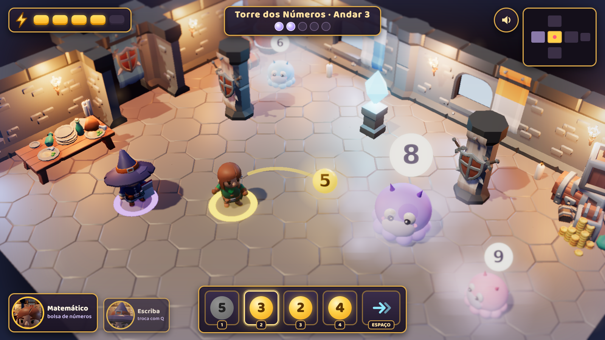
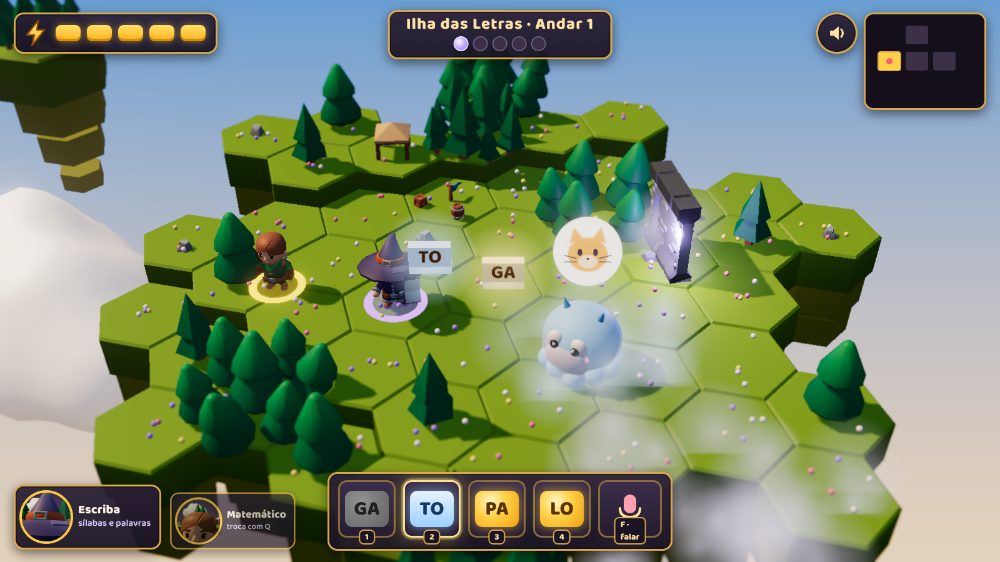
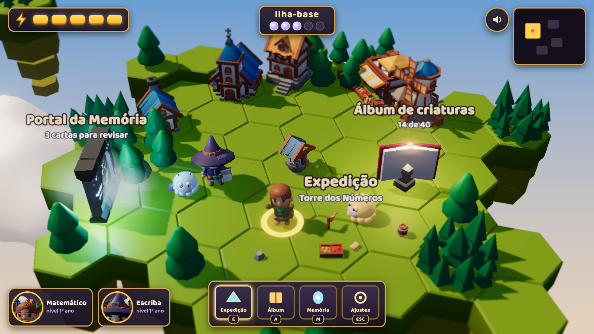

# Arquipélago do Céu

Roguelite educativo em 3D isométrico, feito em Godot, para crianças de 6 a 10 anos aprenderem matemática e português jogando.

## O jogo

Uma névoa do esquecimento cobriu as ilhas do céu: criaturas esqueceram seus nomes, máquinas perderam seus números. A criança parte do Lobby e sobe as torres das dungeons, geradas proceduralmente, uma por disciplina, para restaurar o que a névoa apagou.

- **Matemático**: carrega uma bolsa de números e operações. Cada criatura mostra um escudo com um número, e a criança monta a conta que chega nele.
- **Escriba**: as criaturas esqueceram o próprio nome. No 1º ano a criança junta sílabas, no 2º escreve a palavra, no 3º completa frases.
- **Combate em tempo real, sem violência**: ao atacar, o tempo desacelera para a criança pensar. O acerto dissolve a névoa e a criatura entra no Álbum de criaturas.
- **Aprendizado**: revisão espaçada, dificuldade adaptativa, desafios opcionais do ano seguinte e voz em todas as instruções.

## Estrutura

```text
docs/
  produto/       gameplay, mundo, conteúdo educacional e escopo do MVP
  tecnico/       arquitetura, Godot/C#, geração procedural, conteúdo e cliente de rede (o backend é outro repositório)
  arte-e-ux/     direção de arte, HUD e acessibilidade
  apresentacao/  resumo do jogo
mockups/         telas de referência em 3D
```

## Como trabalhamos

O desenvolvimento segue um fluxo único, com skills do Claude Code instaladas em `.claude/skills/`:

```text
(/wayfinder | /grill-with-docs)  ->  /to-tickets  ->  /implement
```

| Etapa | Quando usar | O que produz |
| --- | --- | --- |
| `/setup-matt-pocock-skills` | Uma vez por repositório | Define onde ficam os tickets (GitHub Issues ou Markdown local) e grava a configuração no `CLAUDE.md` |
| `/wayfinder` | O trabalho é grande (várias sessões) e o caminho ainda não está claro | Um mapa de tickets de decisão, resolvidos um a um até não sobrar nada a decidir. Só planeja, não escreve código |
| `/grill-with-docs` | O trabalho cabe numa sessão e o plano ainda está vago | Entrevista até o plano ficar claro e grava o vocabulário em `GLOSSARY.md` e as decisões difíceis em ADRs |
| `/to-tickets` | Já existe um plano ou spec | Tickets pequenos, cada um uma fatia completa e demonstrável, com as dependências entre eles |
| `/implement` | Há um ticket (ex.: `/implement #12`) ou uma spec | Implementa com testes primeiro (TDD), roda os testes, pede revisão e faz commit na branch atual |

Quando o fluxo apontar uma mudança que contradiz algo já decidido, o documento correspondente em `docs/` é atualizado. Guias detalhados de cada skill estão em `docs/referencia/skills/`.

## Ambiente

Para rodar o jogo: .NET SDK 8, Godot 4.7.2 (versão .NET) e Node LTS (validação do schema das missões). A variável `GODOT` deve apontar para o executável de console do Godot. O backend não faz parte deste repositório.

### Como rodar

O projeto Godot está em `game/`. No PowerShell, na raiz do repositório (a variável `GODOT` já aponta para o executável de console):

```powershell
# compilar o C#
dotnet build game/ArquipelagoDoCeu.csproj

# abrir o jogo (janela)
& $env:GODOT --path game

# rodar sem janela e sair depois de alguns quadros (teste rápido)
& $env:GODOT --headless --path game --quit-after 30
```

Para rodar todos os testes (não precisam do Godot aberto; a CI roda este mesmo comando a cada pull request):

```powershell
dotnet test game.tests
```

Para editar no Godot, abra a pasta `game/` pelo gerenciador de projetos. A cena inicial, `Main`, monta o Lobby, o Personagem do Perfil e as telas de Perfil e de Personagem.

Controles no Lobby: WASD ou setas (relativo à tela), roda do mouse, pinça ou Page Up e Page Down para o zoom (Home reinicia), clique do mouse ou toque no chão para ir até lá (o caminho contorna árvores e lagoa). Perto do Álbum ou do portal aparece um botão (ou a tecla E) para usar o objeto. Em Configurações dá para mudar tamanho do texto, voz, redução de animações, fonte para dislexia, Modo calmo e as dicas de controle; tudo é gravado no save.

### Piloto de desenvolvimento

O `DevDriver` percorre o jogo como uma criança faria (clica, digita, segura teclas) e grava capturas. Só liga com argumentos de usuário, depois do `--`; rode com janela, não com `--headless`, para as capturas saírem:

```powershell
& $env:GODOT --path game -- --driver=movimento --saida=C:\caminho\da\pasta
```

Cenários: `criar`, `escolher`, `personagem`, `movimento`, `mouse`, `lobby`, `album`, `portal`, `tecla`, `config`, `animacao` (imprime no console se a animação de andar está ligada), `camera`, `efeitos`, `boneco`, `boneco-dislexia`, `erro`, `energia`, `bolha`, `calmo`, `treino-nivel`, `nome`, `nome-erro`, `nivel2-matematica`, `nivel2-escrita` e `nivel3-frase`. `--reduzir-animacoes` liga a redução de animações e `--nivel=N` libera os Níveis até N no treino. O piloto trabalha numa cópia do save do usuário, então não mexe nos seus Perfis.

### Teste de ponta a ponta

O roteiro `e2e-1` cria o Perfil, anda, treina nos dois Papéis e confere que o save não mudou; o `e2e-2`, num segundo processo, reabre o jogo e confere que o Perfil e o progresso são os mesmos. Uma verificação que falha faz o jogo sair com código 1. A CI roda os dois no executável de depuração exportado (job `e2e-windows`). Para rodar aqui, sem janela:

```powershell
$save = "$env:TEMP\e2e-save.json"; Remove-Item $save, "$save.snapshot" -ErrorAction SilentlyContinue
& $env:GODOT --headless --path game -- --driver=e2e-1 --save=$save
& $env:GODOT --headless --path game -- --driver=e2e-2 --save=$save
```

## Telas de referência

| Torre dos Números | Torre das Letras | Lobby |
| --- | --- | --- |
|  |  |  |
